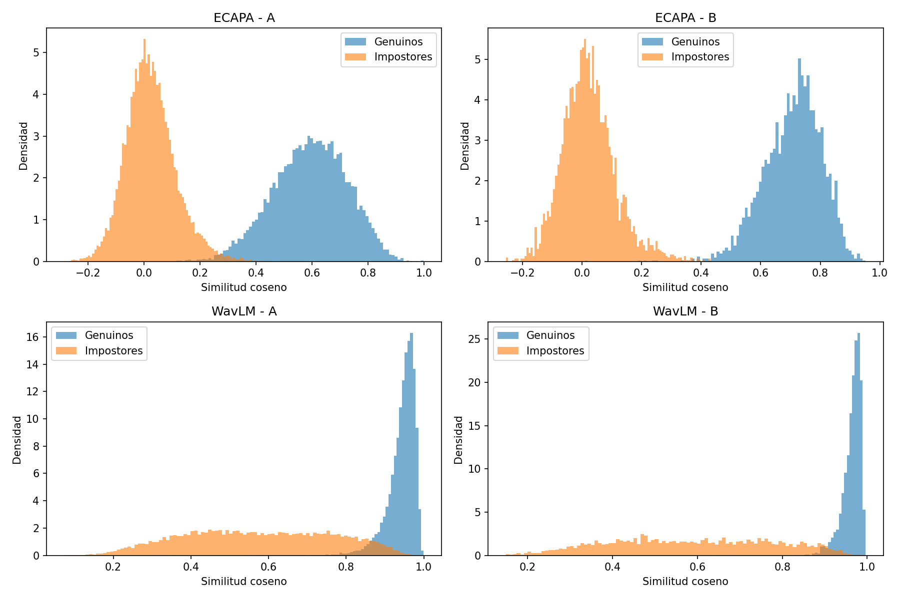
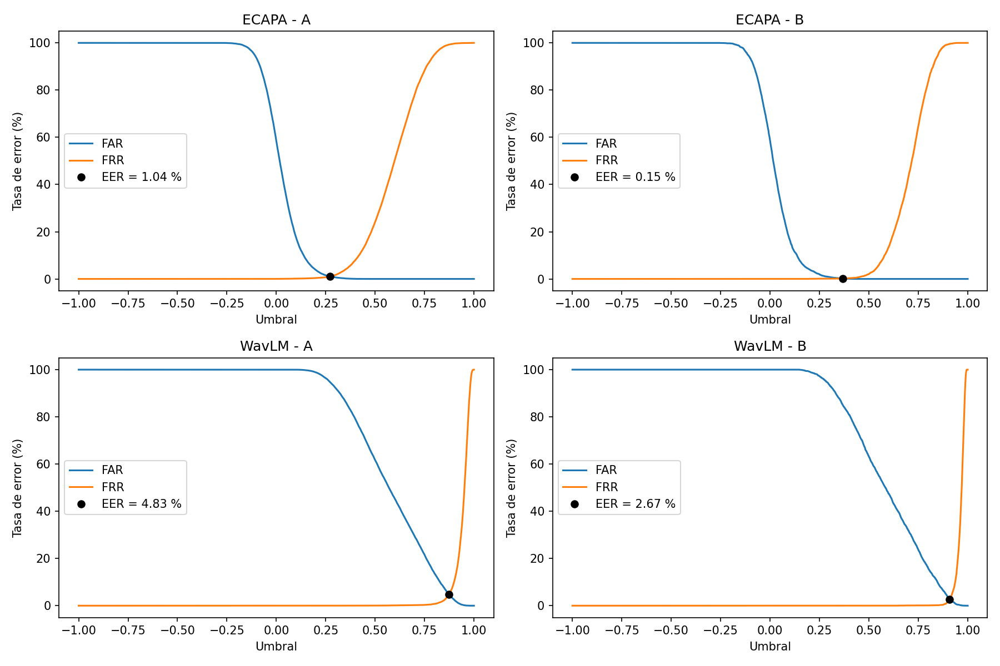
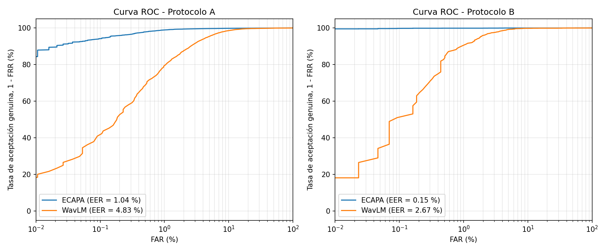

## Descripción

Sistema que decide si dos grabaciones de voz pertenecen a la misma persona. Cada audio se representa con un embedding obtenido de un modelo preentrenado y se compara con similitud coseno. Se evalúan dos modelos y dos protocolos sobre VoxCeleb1-O.

**Modelos**

| Modelo | Fuente | Entrada | Embedding |
|---|---|---|---|
| ECAPA-TDNN | `speechbrain/spkrec-ecapa-voxceleb` | Banco de filtros Mel | 192 |
| WavLM-Base-Plus-SV | `microsoft/wavlm-base-plus-sv` | Forma de onda | 512 |

**Protocolos**

- **A, verificación individual:** 37.720 pares oficiales de VoxCeleb1-O (18.860 genuinos y 18.860 impostores). Se compara un audio contra otro.
- **B, verificación con registro:** protocolo del equipo docente. Cada uno de los 40 locutores se registra con 10 grabaciones, que se promedian en un embedding único (huella). Se evalúan 8.630 comparaciones (4.315 genuinas y 4.315 impostoras) entre la huella y un audio de prueba.

## Estructura

```
├── tarea3_verificacion_locutor.ipynb   Notebook con todo el código
├── requirements.txt                    Librerías y versiones usadas
├── protocolo_vox1/                     Listas de los dos protocolos
├── histogramas.png                     Distribución de puntajes
├── far_frr.png                         Curvas FAR y FRR con el EER
└── roc.png                             Curvas ROC
```

## Cómo ejecutar (Google Colab)

1. Abrir el notebook en Colab y activar la GPU: *Entorno de ejecución → Cambiar tipo de entorno → T4 GPU*.
2. Subir `protocolo_T3_VerificacionLocutor.zip` a Google Drive, en la carpeta `MyDrive/T3/`.
3. Pedir acceso al dataset [ProgramComputer/voxceleb](https://huggingface.co/datasets/ProgramComputer/voxceleb) en Hugging Face y crear un token de tipo **Read** (*Settings → Access Tokens*).
4. Ejecutar las celdas en orden. Cuando la celda de `login()` lo pida, pegar el token. El token no queda guardado en el notebook.

El notebook descarga los audios de prueba de VoxCeleb1 (1,07 GB, 4.874 archivos WAV a 16 kHz), calcula los embeddings de los 4.715 audios que usan los protocolos y los guarda en Drive. Después calcula los puntajes, los histogramas, el EER y las curvas ROC.

Tiempo de extracción de embeddings en una GPU T4: ECAPA 1 min 26 s y WavLM 4 min 58 s.

## Resultados

| Modelo | Protocolo A (EER) | Protocolo B (EER) |
|---|---|---|
| ECAPA-TDNN | 1,04 % (umbral 0,272) | 0,15 % (umbral 0,369) |
| WavLM-Base-Plus-SV | 4,83 % (umbral 0,874) | 2,67 % (umbral 0,908) |





## Datos

Los audios de VoxCeleb1 no se incluyen en este repositorio. Pertenecen a sus autores originales y se descargan desde Hugging Face al ejecutar el notebook.

Nagrani, A., Chung, J. S., & Zisserman, A. (2017). VoxCeleb: a large-scale speaker identification dataset. Interspeech.
